<div align="center">

  

  # 🌐 Awesome Service Discovery &amp; Mesh

  <p align="center">
    <strong>A curated directory of top-tier Service Discovery, Dynamic Registries, Envoy Proxies, Zero-Trust mTLS &amp; Cloud-Native Service Mesh architectures.</strong>
  </p>

  <p align="center">
    <a href="https://github.com/ishandutta2007/Awesome-Awesome-Awesome"></a><a href="https://discord.gg/jc4xtF58Ve"></a>
    <a href="https://github.com/ishandutta2007/Awesome-Service-Discovery-Mesh/stargazers"></a>
    <a href="https://github.com/ishandutta2007/Awesome-Service-Discovery-Mesh/network/members"></a>
    <a href="https://github.com/ishandutta2007/Awesome-Service-Discovery-Mesh/blob/main/LICENSE"></a>
    <a href="https://github.com/ishandutta2007/Awesome-Service-Discovery-Mesh/pulls"></a>
    <a href="https://github.com/ishandutta2007"></a>
  </p>

</div>

---

## 📖 Overview &amp; Architecture Landscape

In distributed microservices, applications need to seamlessly locate and communicate with dynamic upstream services without hardcoded IP addresses or brittle static DNS records. **Service Discovery** solutions maintain real-time registries of healthy service endpoints, propagating changes across nodes in milliseconds. **Service Mesh** infrastructures augment this with transparent Layer 4 and Layer 7 proxies, enforcing **mutual TLS (mTLS) zero-trust encryption**, circuit breaking, distributed rate limiting, traffic shifting (canary &amp; blue-green), and end-to-end telemetry.

Whether orchestrating workloads on **Kubernetes**, legacy virtual machines (VMs), bare metal, or hybrid multi-cloud topologies, selecting the right registry and mesh architecture directly dictates your cluster latency, consistency guarantees (AP vs. CP), and operational overhead.

---

## 📑 Table of Contents

- [🌐 Sector Overview &amp; Market Dynamics](#-sector-overview--market-dynamics)
- [☁️ SaaS &amp; Managed Service Discovery / Mesh Platforms](#️-saas--managed-service-discovery--mesh-platforms)
- [🔓 Open-Source GitHub Projects (Ranked by Stars)](#-open-source-github-projects-ranked-by-stars)
- [📊 Architectural Comparison Matrix](#-architectural-comparison-matrix)
- [🤝 How to Contribute](#-how-to-contribute)
- [📈 Star History](#-star-history)
- [💖 Support &amp; Sponsorship](#-support--sponsorship)
- [⚖️ Disclaimer](#️-disclaimer)

---

## 🌐 Sector Overview &amp; Market Dynamics

The global **Service Mesh and Cloud-Native Service Discovery market** was valued at approximately **$2.4 Billion in 2024** and is projected to surpass **$7.8 Billion by 2030**, exhibiting a robust Compound Annual Growth Rate (**CAGR of ~26.4%**). This accelerating growth is propelled by widespread enterprise migration toward microservices, zero-trust cybersecurity mandates requiring automated mTLS encryption, and multi-region Kubernetes adoption.

Market concentration follows a two-tier paradigm:
1. **Cloud Registry &amp; DNS Layer (Highly Concentrated)**: Public cloud hyperscalers (Microsoft Azure, AWS, and Google Cloud) dominate managed infrastructure registries and private DNS zones, benefiting from deep integration with identity and container runtimes.
2. **Service Mesh Control &amp; Data Plane Layer (Moderately Fragmented around Envoy &amp; eBPF)**: The control and data plane landscape exhibits vigorous competition centered around the CNCF **Envoy proxy** standard (powering Istio, Kuma, and enterprise distributions like Kong Konnect and Gloo Mesh), while modern architectural shifts—such as **ambient sidecarless meshes** and **eBPF-driven networking (Cilium)**—are actively challenging traditional sidecar deployment models to slash latency and compute overhead.

---

## ☁️ SaaS &amp; Managed Service Discovery / Mesh Platforms

The table below outlines leading enterprise hosted and managed SaaS solutions, sorted in descending order by parent company scale (market capitalization or latest enterprise valuation):

| Platform | Company &amp; Scale (Valuation / Revenue) | Starting Tier Price | Free Tier / Free Trial Limits | Key Capabilities &amp; Architecture Focus |
| :--- | :--- | :--- | :--- | :--- |
| **[Azure Private DNS](https://azure.microsoft.com/en-us/products/private-dns/)** | **Microsoft Corporation**<br>📊 Valuation: ~$3.12T Market Cap<br>💰 FY24 Revenue: $245.1B | **$0.50 / month** per DNS zone (for the first 25 zones); **$0.40 per 1M** DNS queries | **30-day $200 Azure credit** + 12 months select free services (covers up to 5 private hosted zones and 1M queries during trial period) | Fully managed private DNS name resolution within Azure Virtual Networks (VNets), native auto-registration for Azure VMs, split-horizon DNS, and zero-data-exfiltration integration with Azure Private Link. |
| **[AWS Cloud Map](https://aws.amazon.com/cloud-map/)** | **Amazon Web Services (AWS)**<br>📊 Valuation: ~$2.14T Market Cap<br>💰 FY24 Revenue: $620B (AWS: ~$105B) | **$0.10 / month** per registered resource; **$1.00 per 1M** HTTP discovery API calls ($0.40/1M for Route 53 DNS queries) | **1,000,000 discovery API calls / month free forever** under AWS Free Tier (first 12 months); resource registration covered by initial $300 AWS Free Tier / Activate credits | Fully managed dynamic service registry tightly coupled with Amazon ECS, EKS, and EC2. Supports dual discovery mechanisms via custom DNS records or direct `DiscoverInstances` REST APIs with built-in health checking. |
| **[Google Cloud Service Directory](https://cloud.google.com/service-directory)** | **Google Cloud (Alphabet Inc.)**<br>📊 Valuation: ~$2.10T Market Cap<br>💰 FY24 Revenue: $350B (GCP: ~$40B) | **$0.10 / month** per 1,000 service endpoints; **$1.00 per 1M** lookup API calls | **Always-Free Tier**: up to 1,000 registered endpoints and 1,000,000 lookup requests per month free forever; plus **90-day $300 credit** trial for new accounts | Unified multi-cloud and hybrid service registry providing high-scale API, DNS, and Cloud DNS routing across Google Kubernetes Engine (GKE), Compute Engine VMs, and external on-premises microservices. |
| **[Google Cloud Service Mesh](https://cloud.google.com/service-mesh)** | **Google Cloud (Alphabet Inc.)**<br>📊 Valuation: ~$2.10T Market Cap<br>💰 FY24 Revenue: $350B (GCP: ~$40B) | **$0.005 per vCPU-hour** (~$3.65 / vCPU / month) standalone, or included within GKE Enterprise at **$0.00822 per vCPU-hour** | **30-day free trial** of GKE Enterprise covering up to 100 vCPUs; eligible for full consumption under Google Cloud's **90-day $300 credit** onboarding program | Fully managed enterprise Istio control and data plane with Google-managed Certificate Authority (Mesh CA), zero-maintenance automated version upgrades, cross-cluster multi-cloud mesh, and built-in SLO health dashboards. |
| **[HashiCorp Consul on HCP](https://www.hashicorp.com/cloud)** | **HashiCorp / IBM**<br>📊 Valuation: $6.4B Acquisition<br>💰 IBM Market Cap: ~$210B | **$0.015 / hour** (~$10.95 / month) for Developer tier; **$0.027 / client-hour** (~$19.71 / client / month) for Standard production clusters | **$50 free cloud credit** upon HCP registration valid for **30 days** (sufficient to execute a development Consul cluster for ~150 hours continuously without payment) | Fully managed HashiCorp Consul SaaS on AWS and Microsoft Azure. Provides push-button multi-region WAN federation, cluster peering, automated snapshot backups, and zero-client Consul Dataplane integration. |
| **[Kong Konnect](https://konghq.com/products/kong-konnect)** | **Kong Inc.**<br>📊 Valuation: ~$1.4B - $2.0B<br>💰 ARR: $100M+ | **$250 / month** for Plus tier (includes 3 runtime instances, then $85/mo per additional runtime); Serverless tier starts at **$0.02 per 10k requests** | **Free-forever Developer tier**: includes 1 Control Plane, 1 Data Plane runtime instance, up to 5 services, and 100,000 API requests/month; **30-day Enterprise trial** with unlimited runtimes | Cloud-hosted SaaS management plane orchestrating both Kuma-based Kong Mesh and Kong API Gateway instances across Kubernetes, Linux VMs, bare metal, and edge cloud environments with unified RBAC. |
| **[Solo.io Gloo Mesh](https://www.solo.io/products/gloo-mesh/)** | **Solo.io**<br>📊 Valuation: ~$1.02B Unicorn<br>💰 Raised: $171.5M | **$1,250 / node / year** (~$104.16 / node / month) for enterprise production license and 24/7 SLA support | **30-day full-featured enterprise trial** including pre-configured multi-cluster sandbox labs, virtual mesh training environments, and unlimited trial node support | Enterprise-hardened management plane built on Istio and Envoy. Provides centralized multi-cluster routing, unified virtual mesh abstractions, declarative zero-trust security policies, and GraphQL data plane federation. |
| **[Tetrate Service Bridge (TSB)](https://www.tetrate.io/tetrate-service-bridge/)** | **Tetrate**<br>📊 Valuation: ~$350M<br>💰 Raised: $52.5M Series B | **$1,000 / cluster / month** (~$12,000 / year base entry tier) for enterprise multi-cluster management | **14-day free trial** on Tetrate Cloud sandbox platform with guided interactive tutorials, pre-provisioned Envoy proxies, and telemetry dashboards | Comprehensive application connectivity platform designed for Fortune 500 hybrid estates. Unifies management of Istio, Envoy proxies, and Apache SkyWalking across traditional data centers and multi-cloud Kubernetes. |
| **[Buoyant Cloud](https://buoyant.io/cloud)** | **Buoyant**<br>📊 Valuation: ~$75M<br>💰 Raised: ~$14M | **$18 / node / month** (or **$2,000 / cluster / month** for full Linkerd Enterprise management plane) | **Free-forever Starter tier**: supports small teams and development clusters up to **50 workloads / 1 cluster**; plus a **30-day Enterprise trial** for multi-cluster environments | Managed control and operations dashboard tailored specifically for Linkerd. Automates cross-cluster mTLS certificate rotation, provides real-time route topology metrics, and tracks CVE security advisories. |

---

## 🔓 Open-Source GitHub Projects (Ranked by Stars)

Below are the most prominent, battle-tested open-source projects for service registry, dynamic discovery, edge proxies, and transparent service meshes—ordered strictly in **descending order by GitHub Stars_Count**:

### 1. [Traefik](https://github.com/traefik/traefik) [](https://github.com/traefik/traefik/stargazers)
- **License**: Apache-2.0 | **Primary Language**: Go
- **Architecture**: Dynamic Reverse Proxy, Ingress Controller &amp; Edge Router
- **Overview**: The leading cloud-native HTTP reverse proxy and load balancer designed to integrate directly with existing service registries (Docker, Swarm, Kubernetes, Consul, etcd, ZooKeeper, and Redis). Traefik automatically discovers new microservices as they spin up and configures routing rules, SSL/TLS certificates (via Let's Encrypt), and circuit breakers in real time without restarting processes or reloading config files.

### 2. [etcd](https://github.com/etcd-io/etcd) [](https://github.com/etcd-io/etcd/stargazers)
- **License**: Apache-2.0 | **Primary Language**: Go
- **Architecture**: CP Distributed Key-Value Store &amp; Registry Engine (Raft Consensus)
- **Overview**: A strongly consistent, distributed key-value store that serves as the backbone of Kubernetes cluster state and service coordination. Offers reliable service registration through leases (heartbeats) and instantaneous change propagation via its streaming gRPC `Watch` API. Heavily utilized in gRPC-native architectures through custom client `NameResolver` implementations.

### 3. [Istio](https://github.com/istio/istio) [](https://github.com/istio/istio/stargazers)
- **License**: Apache-2.0 | **Primary Language**: Go / C++ (CNCF Graduated)
- **Architecture**: Comprehensive Service Mesh (Sidecar &amp; Ambient Modes)
- **Overview**: The industry benchmark for enterprise service meshes. Istio injects an Envoy-based data plane proxy beside each application pod (or deploys per-node shared `ztunnel` in **Ambient Mode** to eliminate sidecar restarts). Provides industry-leading Layer 7 traffic routing (`VirtualService`, `DestinationRule`), canary deployments, fault injection, automatic mutual TLS (mTLS), and fine-grained `AuthorizationPolicy` access control.

### 4. [go-zero](https://github.com/zeromicro/go-zero) [](https://github.com/zeromicro/go-zero/stargazers)
- **License**: MIT | **Primary Language**: Go
- **Architecture**: High-Performance Microservices Framework with Built-in Discovery
- **Overview**: A web and RPC framework engineered to sustain massive concurrency. Features native client-side load balancing, service registration and discovery via etcd or Consul, adaptive rate limiting, circuit breaking, and automated resilience engineering out of the box with zero external sidecar latency.

### 5. [HashiCorp Consul](https://github.com/hashicorp/consul) [](https://github.com/hashicorp/consul/stargazers)
- **License**: MPL-2.0 / BSL | **Primary Language**: Go
- **Architecture**: Multi-Platform Service Discovery, KV Store &amp; Service Mesh
- **Overview**: The reference standard for multi-datacenter, hybrid-cloud service registry and mesh networking. Unifies Kubernetes clusters with legacy VM and bare-metal fleets through built-in health checking, native DNS resolution, and HTTP REST APIs. Features WAN federation, cluster peering, L4/L7 service intentions, and the lightweight **Consul Dataplane** proxy.

### 6. [Envoy](https://github.com/envoyproxy/envoy) [](https://github.com/envoyproxy/envoy/stargazers)
- **License**: Apache-2.0 | **Primary Language**: C++ (CNCF Graduated)
- **Architecture**: Universal Cloud-Native High-Performance Edge &amp; Service Proxy
- **Overview**: The foundational data plane proxy that powers modern service meshes (including Istio, Kuma, Consul, AWS App Mesh, and Gloo Mesh). Originally built at Lyft, Envoy provides out-of-process Layer 7 filtering, advanced dynamic discovery services (xDS: LDS, RDS, CDS, EDS), active/passive health checking, and transparent TLS termination with negligible memory and CPU overhead.

### 7. [Dapr](https://github.com/dapr/dapr) [](https://github.com/dapr/dapr/stargazers)
- **License**: Apache-2.0 | **Primary Language**: Go (CNCF Incubating)
- **Architecture**: Distributed Application Runtime &amp; Service Invocation Engine
- **Overview**: Provides language-agnostic building blocks via standard HTTP and gRPC APIs. Its **Service Invocation** component automates service discovery, name resolution (integrating with mDNS, Consul, or Kubernetes DNS), zero-trust mTLS encryption, automated retries, and distributed tracing without tying application code to specific networking SDKs.

### 8. [Cilium](https://github.com/cilium/cilium) [](https://github.com/cilium/cilium/stargazers)
- **License**: Apache-2.0 | **Primary Language**: Go / C / eBPF (CNCF Graduated)
- **Architecture**: eBPF-Powered Networking, Observability &amp; Sidecarless Service Mesh
- **Overview**: Revolutionizes service mesh architecture by executing traffic management, L3/L4 filtering, and high-performance routing directly within the Linux kernel using **eBPF**. Cilium Service Mesh can run without sidecar proxies for HTTP/gRPC routing, mutual authentication, and load balancing, drastically reducing latency and memory footprints compared to traditional Envoy sidecars.

### 9. [CoreDNS](https://github.com/coredns/coredns) [](https://github.com/coredns/coredns/stargazers)
- **License**: Apache-2.0 | **Primary Language**: Go (CNCF Graduated)
- **Architecture**: Modular DNS Server &amp; Kubernetes Internal Service Registry
- **Overview**: The default in-cluster DNS service discovery engine across standard Kubernetes deployments (replacing legacy `kube-dns`). Operates via a flexible plugin chain (`Corefile`) to dynamically resolve `service.namespace.svc.cluster.local` names directly from the Kubernetes API, complete with caching, rewrite rules, and Prometheus metrics.

### 10. [Apache ZooKeeper](https://github.com/apache/zookeeper) [](https://github.com/apache/zookeeper/stargazers)
- **License**: Apache-2.0 | **Primary Language**: Java
- **Architecture**: CP Distributed Coordination Engine &amp; Ephemeral Service Registry
- **Overview**: The battle-tested coordination service behind Apache Kafka, Hadoop, and Solr. Manages dynamic service discovery through hierarchical ephemeral znodes (`/services/{service-name}/instance-id`). Employs the Paxos-variant ZAB consensus protocol to guarantee strong data consistency across distributed clusters during network partitions.

### 11. [Eureka](https://github.com/Netflix/eureka) [](https://github.com/Netflix/eureka/stargazers)
- **License**: Apache-2.0 | **Primary Language**: Java
- **Architecture**: AP Availability-Prioritized Service Registry (Netflix OSS)
- **Overview**: Netflix's purpose-built, cross-region service registry designed to favor availability over absolute consistency (AP). Services register via REST APIs and maintain active status through 30-second heartbeats. Clients cache registry catalogs locally, ensuring service resolution continues uninterrupted even during complete Eureka server cluster blackouts.

### 12. [Linkerd](https://github.com/linkerd/linkerd2) [](https://github.com/linkerd/linkerd2/stargazers)
- **License**: Apache-2.0 | **Primary Language**: Rust / Go (CNCF Graduated)
- **Architecture**: Ultralight, Simplicity-First Kubernetes Service Mesh
- **Overview**: Renowned for unmatched operational simplicity and blazing speed. Linkerd utilizes micro-proxies written in memory-safe **Rust** (`linkerd2-proxy`) that incur less than 1ms of p99 latency overhead. Automatically provisions zero-config mutual TLS (mTLS) with 24-hour cryptographic certificate rotations and exponentially weighted moving average (EWMA) load balancing.

### 13. [Apache ShenYu](https://github.com/apache/shenyu) [](https://github.com/apache/shenyu/stargazers)
- **License**: Apache-2.0 | **Primary Language**: Java
- **Architecture**: Reactive Microservices API Gateway &amp; Registry Integrator
- **Overview**: An asynchronous, high-performance API gateway engineered for enterprise Java ecosystems. Seamlessly bridges traffic between HTTP and microservice protocols (Dubbo, gRPC, Spring Cloud, Tars) with dynamic service discovery integration supporting etcd, Consul, ZooKeeper, and Nacos.

### 14. [HashiCorp Serf](https://github.com/hashicorp/serf) [](https://github.com/hashicorp/serf/stargazers)
- **License**: MPL-2.0 | **Primary Language**: Go
- **Architecture**: Decentralized Cluster Membership &amp; Gossip-Based Failure Detector
- **Overview**: A lightweight, decentralized coordination library utilizing the SWIM gossip protocol. Operates without centralized servers or single points of failure, propagating node join/leave events and node outages across thousands of machines in sub-second timeframes with minimal bandwidth overhead.

### 15. [Netflix Ribbon](https://github.com/Netflix/ribbon) [](https://github.com/Netflix/ribbon/stargazers)
- **License**: Apache-2.0 | **Primary Language**: Java
- **Architecture**: Client-Side IPC Load Balancer with Eureka Discovery Integration
- **Overview**: The historic foundational client-side load balancing library from the Netflix OSS stack. Integrates directly with Eureka to dynamically inspect healthy instance pools and execute zone-aware, round-robin, and response-time weighted routing. (Largely succeeded by Spring Cloud LoadBalancer in modern cloud deployments).

### 16. [MOSN](https://github.com/mosn/mosn) [](https://github.com/mosn/mosn/stargazers)
- **License**: Apache-2.0 | **Primary Language**: Go
- **Architecture**: Cloud-Native Proxy &amp; Service Mesh Data Plane (Ant Group)
- **Overview**: An enterprise-grade, memory-efficient proxy developed in Go by Ant Group and battle-tested during Alibaba's 11.11 Global Shopping Festival. Fully compliant with Envoy's xDS APIs, supporting multi-protocol routing (Dubbo, Sofa, HTTP/1.1, HTTP/2) and secure mTLS zero-trust communication.

### 17. [Kuma](https://github.com/kumahq/kuma) [](https://github.com/kumahq/kuma/stargazers)
- **License**: Apache-2.0 | **Primary Language**: Go (CNCF Incubating)
- **Architecture**: Multi-Zone, Platform-Agnostic Service Mesh (Kong)
- **Overview**: Built on top of Envoy by Kong, Kuma delivers a single control plane capable of orchestrating meshes across Kubernetes clusters and bare-metal / VM instances simultaneously. Supports isolated multi-tenant meshes within one control plane, automated multi-zone DNS routing, mTLS, and an intuitive GUI.

### 18. [Traefik Mesh](https://github.com/traefik/mesh) [](https://github.com/traefik/mesh/stargazers)
- **License**: Apache-2.0 | **Primary Language**: Go
- **Architecture**: Lightweight Kubernetes Service Mesh (SMI Compliant)
- **Overview**: A straightforward, opt-in service mesh built on the Traefik proxy. Features non-invasive installation where existing cluster services remain unaffected until explicitly configured with Kubernetes annotations or Service Mesh Interface (SMI) resources.

### 19. [SOFARegistry](https://github.com/sofastack/sofa-registry) [](https://github.com/sofastack/sofa-registry/stargazers)
- **License**: Apache-2.0 | **Primary Language**: Java
- **Architecture**: Ultra-Large-Scale Production Service Registry (SOFAStack)
- **Overview**: A production-grade distributed service registry developed by Ant Group to overcome standard registry scaling limits. Features a decoupled three-tier architecture (Session, Data, and Meta clusters) capable of maintaining millions of microservice instances and real-time push subscriptions.

---

## 📊 Architectural Comparison Matrix

| Project | Primary Model | Consensus / CAP | Data Plane Engine | mTLS Encryption | Multi-DC / Multi-Cloud | Primary Sweet Spot |
| :--- | :--- | :--- | :--- | :--- | :--- | :--- |
| **Traefik** | Reverse Proxy / Router | N/A (Stateless) | Native Go Core | ✅ Automatic | ✅ Cross-Platform | Ingress &amp; dynamic routing for Docker / K8s |
| **etcd** | KV Store / Registry | **CP** (Raft) | gRPC Client Streaming | ✅ Mutual Auth | ⚠️ Manual Federation | Kubernetes state &amp; custom gRPC registries |
| **Istio** | Service Mesh | N/A (K8s API) | Envoy / Ambient ztunnel | ✅ Automatic | ✅ Native Multi-Cluster | Enterprise Kubernetes with rich L7 traffic control |
| **HashiCorp Consul** | Registry &amp; Service Mesh | **CP** (Raft) | Envoy / Consul Dataplane | ✅ Intentions Based | ✅ Built-in WAN Peering | Hybrid enterprises bridging VMs and Kubernetes |
| **Envoy** | Universal Proxy | N/A (xDS APIs) | C++ Event Loop | ✅ Native Engine | ✅ Universal | High-performance Layer 7 sidecar / gateway core |
| **Cilium** | eBPF Service Mesh | N/A (K8s API) | Linux Kernel eBPF + Envoy | ✅ WireGuard / IPsec | ✅ Cluster Mesh | Sidecarless, low-latency Kubernetes networking |
| **CoreDNS** | Cluster DNS | N/A (Stateless) | Go DNS Engine | ❌ Plain DNS | ⚠️ Stub Domains | Default Kubernetes in-cluster name resolution |
| **Apache ZooKeeper** | Coordination Engine | **CP** (ZAB Paxos) | Ephemeral Session TCP | ⚠️ TLS Auth | ❌ Single Cluster Cluster | Legacy Java distributed coordination &amp; Kafka |
| **Netflix Eureka** | Service Registry | **AP** (Gossip/Poll) | Client-Side Cache | ⚠️ Custom HTTPS | ✅ Cross-Region AP | Spring Cloud Java apps prioritizing availability |
| **Linkerd** | Service Mesh | N/A (K8s API) | `linkerd2-proxy` (Rust) | ✅ Automated &amp; Rotated | ✅ Multi-Cluster Link | Ultra-lightweight, zero-config Kubernetes mesh |
| **Kuma** | Service Mesh | N/A (Postgres/K8s) | Envoy Proxy | ✅ Built-in CA | ✅ Multi-Zone Built-in | Single mesh bridging K8s and VM/Bare Metal |

---

## 🤝 How to Contribute

Contributions, project suggestions, and documentation enhancements are highly encouraged!

1. **Fork the repository** to your own GitHub account.
2. **Create a descriptive feature branch**:
   ```bash
   git checkout -b feat/add-service-mesh-tool
   ```
3. **Commit your modifications** ensuring clear, factual descriptions, links to official documentation, and consistent Markdown table formatting.
4. **Push the branch** and **open a Pull Request** with an informative summary of your changes.

---

## 📈 Star History

[](https://star-history.dera.page/#ishandutta2007/Awesome-Service-Discovery-Mesh&type=date&legend=top-left)

---

## 💖 Support &amp; Sponsorship

If you find this curated ecosystem directory valuable for your microservices architecture, infrastructure planning, or open-source research, please consider supporting the project:

- ⭐ **Star this repository** on GitHub to amplify its visibility!
- 🍴 **Fork the repo** to save your personal reference copy.
- 📢 **Share with fellow DevOps engineers**, platform architects, and SRE teams.
- ☕ **Support continuous maintenance &amp; research** by sponsoring via the link below:

<p align="center">
  <a href="https://github.com/sponsors/ishandutta2007">
    
  </a>
</p>

---

## ⚖️ Disclaimer

- This repository is a **community-curated index** created solely for informational, architectural, and educational purposes. Mention of specific vendors, open-source projects, or commercial SaaS products does not constitute an official endorsement.
- Consistency trade-offs (**AP vs. CP**) significantly impact failure modes: **Eureka** prioritizes availability (tolerating stale service registries), whereas **Consul, etcd, and ZooKeeper** enforce strict consistency (favoring correctness over availability during cluster partitions).
- **Sidecar latency overhead**: Traditional Envoy sidecar models introduce ~0.5ms–1.5ms of p99 latency per network hop; for latency-critical workloads, evaluate **Ambient mode (Istio)** or **eBPF-native data planes (Cilium)**.
- Always perform comprehensive load testing, benchmark proxy memory consumption, and validate high-availability failover mechanisms within non-production environments before deploying service meshes to production.

---

<p align="center">
  <strong>Crafted with ❤️ for platform engineers, SREs, cloud architects, and developers shaping the future of reliable distributed computing.</strong>
</p>
